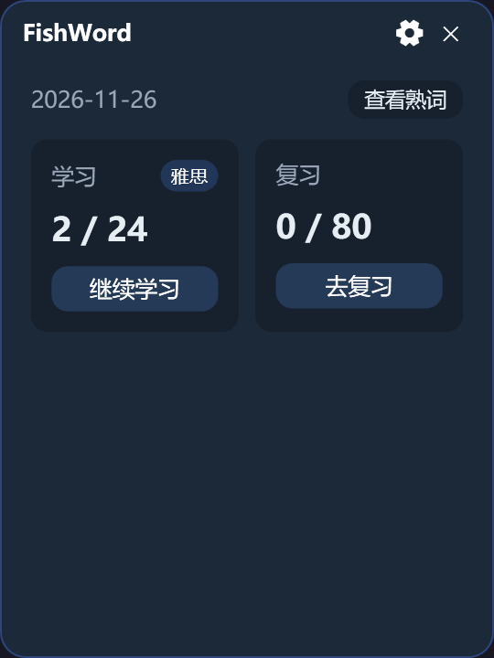
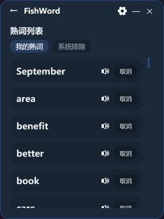
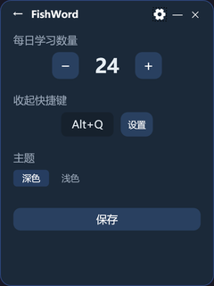
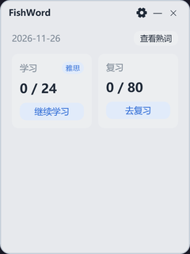

<p align="center">
  
</p>

# FishWord（摸鱼背单词）

Windows 桌面常驻的**半透明背单词悬浮窗**——让用户在工作或游戏之余的碎片时间里随手过几个单词，不打断主工作流程。

技术栈：C# + WPF（.NET 9）+ SQLite，全量数据离线内置。

## 界面预览

<p align="center">
  
  
  
  
  
  
</p>

## 它能做什么

**常驻摸鱼，随手背词** —— 一个 240px 宽的小悬浮窗常驻桌面顶层，工作或者游戏的间隙点开就能背几个单词；点击×按钮或者使用快捷键收起后缩成一个只显示今日进度的圆形气泡，单击或快捷键展开、按住拖动，几乎不占屏幕、不抢注意力。

**科学记忆，不用自己安排** —— 每天定一个目标数，单词按「三遍穿插」的节奏出现（而不是盯着同一个词死磕三遍）；过满三遍自动进入遗忘曲线复习队列，之后每天按记忆衰减规律提醒你复习——忘了就缩短间隔，记住了就拉长间隔，安排交给算法。

**词根串记，举一反三** —— 每个单词自带语素拆分（如 sup（在下）· ply（填充））、主词根与同根词列表、派生词家族树和词源小故事；词根在各个单词里的位置高亮标出，背 supply 的同时就串起了同根的一串词。

**例句真实、干净、好读** —— 例句全部来自 Wiktionary 真实用例，并经过多重清洗：必须包含目标单词、超长句直接舍弃、一段多句时只保留含目标词的那一句；长单词自动用连字符断词不破坏排版，目标单词加粗高亮一眼定位，右键即可复制单词 / 释义 / 例句。

**熟词一键排除** —— 学到不想再看的词，点「熟」就从所有词书的学习与复习队列里全局退出；首次使用时 505 个最基础高频词（on / say / go…）已自动帮你排除。

**四本词书随时切换** —— 内置四级 / 六级 / 雅思 / 托福四本词书，学习与复习进度全局统一：换词书只是换一批新词的来源，背过的单词永远不会重复出现。

**深浅双主题** —— 深色低饱和不显眼，浅色清爽融入白底办公环境，设置页一键切换。

## 快速开始

### 方式一：编译版直接安装（推荐）

下载最新 Release 中的安装包（`FishWord-setup.exe`）或便携版（`FishWord-portable.zip`）：

- 安装包：双击安装，启动后首次运行自动把词库与语音复制到 `%LocalAppData%\FishWord\`，全程离线可用；
- 便携版：解压即用（首次运行同上）。

### 方式二：源码构建（开源版开发指引）

克隆本仓库后可直接运行（词库与语音已内置）：

```powershell
dotnet build src/FishWord.App
dotnet run --project src/FishWord.App
```

环境要求：Windows 10/11（x64）+ .NET 9 SDK（仅构建需要）。

## 未来开发计划

- [ ] **自定义词书导入** —— 上传自己的词表（JSON/CSV），按自己的节奏背；
- [ ] **例句中文释义** —— 为英文例句补充中文翻译；
- [ ] **自定义颜色主题** —— 在现有深/浅主题之上，支持用户导入自定义配色；
- [ ] **联网后台化** —— 词库在线更新、学习进度云同步与多端备份。

## 数据与许可

| 内容 | 许可 |
|------|------|
| 程序代码 | MIT（见 LICENSE） |
| 词库数据（单词/释义/例句/词根/词源） | [CC BY-SA 4.0](https://creativecommons.org/licenses/by-sa/4.0/)（ECDICT + Wiktionary + OpenEtymology 均为 BY-SA 系来源） |
| 语音音频 | 由 edge-tts 合成（微软 Edge 在线语音，仅个人用途） |

## 从零重建词库（仅词库维护者）

> clone 下来即可用，**无需**执行本段。以下仅用于更新词库数据。

```powershell
pip install edge-tts pypdf   # 数据管线依赖

# 1. 单词池（ECDICT，约 207MB 压缩包）
#    下载 https://github.com/skywind3000/ECDICT/releases/download/1.0.28/ecdict-sqlite-28.zip
#    解压到 resources/downloads/ecdict-sqlite-28/
python tools/import_ecdict_words.py --stardict resources/downloads/ecdict-sqlite-28/stardict.db --out resources/fishword.db

# 2. 四本词书
python tools/build_wordbooks.py --db resources/fishword.db

# 3. 例句（kaikki 英文词典 JSONL，约 3.2GB，https://kaikki.org/dictionary/English/）
python tools/import_examples.py --kaikki resources/downloads/kaikki.org-dictionary-English.jsonl --db resources/fishword.db

# 4. 派生词（同上 kaikki 数据）
python tools/import_derivations.py --kaikki resources/downloads/kaikki.org-dictionary-English.jsonl --db resources/fishword.db

# 5. 语素拆分 / 词根 / 词源（OpenEtymology 单词本 PDF，github.com/openetymology/OpenEtymology）
python tools/import_mnemonics.py --db resources/fishword.db

# 6. 全量发音（edge-tts，需联网，断点续跑）
python tools/gen_audio_tts.py --db resources/fishword.db
```

## 项目结构

| 路径 | 说明 |
|------|------|
| `src/FishWord.App` | WPF 悬浮窗应用 |
| `src/FishWord.Core` | 领域模型与调度算法（SM-2 / 穿插） |
| `src/FishWord.Infrastructure` | SQLite 数据访问 |
| `tools/` | 数据管线脚本（Python） |
| `resources/fishword.db` | 成品词库（词库静态数据齐、用户数据空） |
| `resources/audio/` | 全量发音 MP3 |
| `resources/basic_505.json` | 505 基础词自动排除名单 |
| `docs/images/` | README 截图 |
